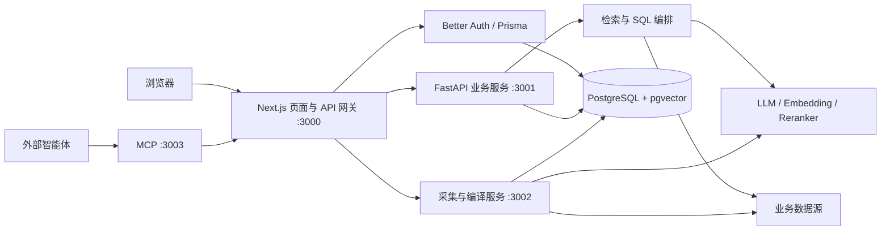

<!--
SPDX-FileCopyrightText: Copyright (c) 2026, NVIDIA CORPORATION & AFFILIATES.
All rights reserved.
SPDX-License-Identifier: Apache-2.0
-->

# Auto-Ontology 项目架构

Auto-Ontology 将数据库元数据整理为可检索、可认证的语义层，再利用该语义层解释自然语言问题、生成并执行 SQL。用户通过 Web 应用维护本体，外部智能体通过只读 MCP 工具访问本体和查询结果。

## 服务与职责

| 模块 | 主要代码 | 职责 |
| --- | --- | --- |
| Web 页面 | `frontend/app`、`frontend/components`、`frontend/common` | Next.js App Router、React 页面和共享组件，涵盖聊天、发现、术语、分析、探索、数据目录及管理设置 |
| API 网关与认证 | `frontend/app/api`、`frontend/auth`、`frontend/proxy.ts` | Better Auth 登录、SSO、OAuth、API 令牌、权限检查和后端请求转发；Prisma 管理认证相关数据 |
| 前端数据访问 | `frontend/api`、`frontend/lib/queries`、`frontend/contexts/QueryProvider.tsx` | 统一请求封装、TanStack Query 缓存、服务端预取及客户端 hydration |
| 业务服务 | `auto_ontology/server` | FastAPI 路由和业务服务；处理目录、术语、SQL 属性、标签、分区、模型导入导出及聊天 |
| 查询编排 | `auto_ontology/retrieval` | LangGraph 流程：意图判断、候选检索、SQL 构建、值与语法验证、执行和结果整理 |
| 采集与语义编译 | `auto_ontology/ingestion_service`、`auto_ontology/catalog`、`auto_ontology/semantic` | 连接数据源、采集元数据和样本、PII 检测、构建语义层并维护嵌入向量 |
| 持久化 | `auto_ontology/dal`、`auto_ontology/vdb`、`alembic` | SQLAlchemy Core 访问 PostgreSQL；pgvector 支持向量检索；Alembic 管理业务数据库结构变更 |
| 智能体入口 | `mcp/auto_ontology_mcp` | FastMCP 只读工具，经 Web 公共 API 访问数据并沿用用户权限 |
| 部署 | `DEPLOYMENT.md`、`docker-compose.yml`、`helm` | Helm 为正式安装入口；Compose 用于本地多服务部署；可选 Vault 存储连接凭据 |

业务服务和采集服务属于内部服务。权限边界在 Next.js API 网关，后端信任网关转发的用户身份，不能把它们当作独立的公网认证入口。MCP 不提供写操作；本体修改通过 Web API 完成。

## 关键流程

1. **页面加载**：根布局获取当前会话和语言；已登录页面预取连接、标签及分区，通过 `HydrationBoundary` 交给客户端复用。路由与页面分别执行相应的权限检查。
2. **数据准备**：采集服务读取外部数据库，建立目录、样本和嵌入向量；语义编译生成术语、列映射、SQL 属性及关系。用户在界面中修订和认证。
3. **问答**：聊天请求经网关进入 FastAPI；查询流程根据本体检索候选、构建与验证 SQL、执行查询。过程步骤、SQL、回答和图表通过 SSE 返回；会话记录由服务端持久化。
4. **MCP 调用**：外部智能体完成 OAuth 授权后使用就绪检查、本体发现、可回答性检查和问答工具，结果受当前用户权限约束。

## 国际化边界

国际化位于 `frontend/i18n`，由服务端解析请求语言，再由 `LocaleProvider` 向客户端组件提供相同语言。中文词典使用英文原文作为键，界面明确调用翻译函数；纯辅助函数显式接收翻译器或语言参数。

语言优先级为：有效的语言 Cookie → 浏览器 `Accept-Language` 中受支持且优先级最高的语言 → 英文。支持 `en` 与 `zh-CN`，`zh`、`zh-Hans`、`zh-CN`、`zh-SG` 浏览器偏好匹配简体中文。语言切换保存在当前浏览器的 Cookie 中；登录前和登录后均可切换。

本次本地化涵盖页面导航、页面标题、表单、操作提示、空状态、无障碍标签、日期、图表数字和固定查询步骤。用户输入、对象名称、SQL、数据库结果、模型生成的回答／推理／图表标题，以及后端或第三方返回的原始错误信息保留原文。界面语言不会改写模型提示词或改变 API 契约。

开发方式和验证命令见 [国际化维护说明](./internationalization.zh-CN.md)。
